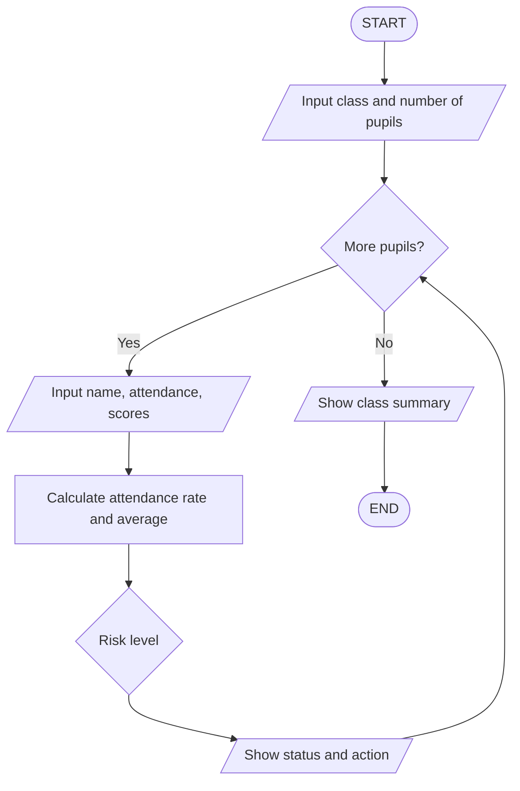

[README (1).md](https://github.com/user-attachments/files/34433146/README.1.md)
# ClassWatch SL: School Attendance and Learning Support Alert System

**Course:** PROG101 Principles of Programming Logic and Design
**Assignment:** Designing Logical Solutions for Sierra Leone Community Challenges
**Topic chosen:** Quality Education
**Student:** UMARO BASHIRU JALLOH 905006538
**Repository name:** `PROG101_ASSIGNMENT1_UMARO_BASHIRU_JALLOH_905006538

> This repository contains a **logical design only** (algorithm, pseudocode, flowcharts and modules). No source code is required for this assignment.

## 1. The problem

Many children in Sierra Leone are in school but are not learning enough, and some leave before they finish. In large classes, teachers record attendance in paper registers and marks in exercise books, so a pupil who is often absent and falling behind is often noticed too late.

## 2. The proposed solution

ClassWatch SL takes each pupil's attendance and subject scores, decides if the pupil is **ON TRACK**, at **MEDIUM RISK** or at **HIGH RISK**, and suggests a simple action for the teacher or head teacher. At the end it shows a class summary.

| Role | What they do |
|------|--------------|
| Class teacher | Enters attendance and scores |
| Head teacher | Reads alerts and arranges support |
| District education office | Reads summary reports (no pupil names) |

## 3. Sustainable Development Goal

**SDG 4: Quality Education.** Target 4.1 (free, equitable and quality education with effective learning outcomes) and Target 4.5 (equal access for the vulnerable).

## 4. Open Source and Digital Public Good

The design is shared under an open licence so that schools, universities and the Ministry can reuse and improve it. It follows the nine-indicator Digital Public Goods Standard: SDG relevance, open licence, clear ownership, documentation, data export in open formats, privacy, standards, do no harm, and protection of personal data.

## 5. Key logic

| Item | Value |
|------|-------|
| Minimum attendance rate | 80 percent |
| Pass mark | 50 |
| Subjects | Mathematics, English, Science |

| Attendance below 80 | Average below 50 | Result |
|---|---|---|
| Yes | Yes | HIGH RISK |
| Yes | No | MEDIUM RISK |
| No | Yes | MEDIUM RISK |
| No | No | ON TRACK |

# ClassWatch SL: Algorithm and Pseudocode

**Course:** PROG101 Principles of Programming Logic and Design
**Topic:** Quality Education (SDG 4)

## 1. Step-by-step algorithm

1. Start.
2. Set the constants: minimum attendance rate (80), pass mark (50), maximum score (100), maximum school days (31), maximum pupils (100) and number of subjects (3).
3. Set highCount, mediumCount and onTrackCount to 0.
4. Display the system title and ask for the class name.
5. Ask for the number of pupils. Repeat the question until a whole number from 1 to 100 is entered (function ReadWholeNumber).
6. Set the pupil counter p to 1.
7. If p is greater than the number of pupils, go to step 20.
8. Ask for the pupil's name.
9. Ask for the number of school days this month (valid range 1 to 31).
10. Ask for the number of days the pupil was present (valid range 0 to school days).
11. Set totalScore to 0. For each of the 3 subjects, ask for the score (valid range 0 to 100) and add it to totalScore.
12. Calculate attendance rate = (days present / school days) x 100.
13. Calculate average score = totalScore / 3.
14. Decide the risk level:
    - If attendance rate is below 80 AND average score is below 50, the level is HIGH RISK.
    - Else if attendance rate is below 80 OR average score is below 50, the level is MEDIUM RISK.
    - Otherwise the level is ON TRACK.
15. Choose a recommended action for that risk level.
16. Display the pupil's attendance, average, risk level and action.
17. Add 1 to the matching counter (high, medium or on track).
18. Add 1 to p.
19. Go back to step 7.
20. Display the class summary: number of pupils, counts for each level, and the percentage needing support.
21. End.

## 2. Pseudocode

```text
START ClassWatchSL
  // ----- Constants (can be changed by the Ministry without changing the logic) -----
  CONSTANT MIN_ATTENDANCE_RATE = 80
  CONSTANT PASS_MARK = 50
  CONSTANT MAX_SCORE = 100
  CONSTANT MAX_SCHOOL_DAYS = 31
  CONSTANT MAX_PUPILS = 100
  CONSTANT NUMBER_OF_SUBJECTS = 3

  // ----- Variables -----
  subjects[1] = "Mathematics" ; subjects[2] = "English" ; subjects[3] = "Science"
  highCount = 0 ; mediumCount = 0 ; onTrackCount = 0

  DISPLAY "CLASSWATCH SL: SCHOOL ATTENDANCE AND LEARNING SUPPORT ALERT SYSTEM"
  INPUT className
  numberOfPupils = ReadWholeNumber("Number of pupils", 1, MAX_PUPILS)

  FOR p = 1 TO numberOfPupils
    INPUT pupilName
    schoolDays = ReadWholeNumber("School days this month", 1, MAX_SCHOOL_DAYS)
    daysPresent = ReadWholeNumber("Days present", 0, schoolDays)
    totalScore = 0
    FOR s = 1 TO NUMBER_OF_SUBJECTS
      scores[s] = ReadWholeNumber("Score for " + subjects[s], 0, MAX_SCORE)
      totalScore = totalScore + scores[s]
    END FOR

    attendanceRate = CalculateAttendanceRate(daysPresent, schoolDays)
    averageScore = CalculateAverage(totalScore, NUMBER_OF_SUBJECTS)
    riskLevel = DetermineRiskLevel(attendanceRate, averageScore)
    action = RecommendAction(riskLevel, attendanceRate)
    DisplayPupilResult(pupilName, attendanceRate, averageScore, riskLevel, action)

    IF riskLevel = "HIGH RISK" THEN
      highCount = highCount + 1
    ELSE IF riskLevel = "MEDIUM RISK" THEN
      mediumCount = mediumCount + 1
    ELSE
      onTrackCount = onTrackCount + 1
    END IF
  END FOR

  DisplayClassSummary(className, numberOfPupils, highCount, mediumCount, onTrackCount)
END ClassWatchSL

FUNCTION ReadWholeNumber(prompt, minValue, maxValue)
  valid = FALSE
  WHILE NOT valid
    DISPLAY prompt
    INPUT value
    IF value is a whole number AND value >= minValue AND value <= maxValue THEN
      valid = TRUE
    ELSE
      DISPLAY "Error: enter a whole number from " + minValue + " to " + maxValue
    END IF
  END WHILE
  RETURN value
END FUNCTION

FUNCTION CalculateAttendanceRate(daysPresent, schoolDays)
  RETURN (daysPresent / schoolDays) * 100
END FUNCTION

FUNCTION CalculateAverage(totalScore, count)
  IF count = 0 THEN
    RETURN 0
  ELSE
    RETURN totalScore / count
  END IF
END FUNCTION

FUNCTION DetermineRiskLevel(attendanceRate, averageScore)
  lowAttendance = attendanceRate < MIN_ATTENDANCE_RATE
  lowPerformance = averageScore < PASS_MARK
  IF lowAttendance AND lowPerformance THEN
    RETURN "HIGH RISK"
  ELSE IF lowAttendance OR lowPerformance THEN
    RETURN "MEDIUM RISK"
  ELSE
    RETURN "ON TRACK"
  END IF
END FUNCTION

FUNCTION RecommendAction(riskLevel, attendanceRate)
  IF riskLevel = "HIGH RISK" THEN
    RETURN "Head teacher to meet parent or guardian this week and arrange extra lessons."
  ELSE IF riskLevel = "MEDIUM RISK" THEN
    IF attendanceRate < MIN_ATTENDANCE_RATE THEN
      RETURN "Class teacher to contact parent or guardian about the absences."
    ELSE
      RETURN "Give extra practice and catch-up support in the weak subjects."
    END IF
  ELSE
    RETURN "Keep it up. Praise the pupil and share good study habits."
  END IF
END FUNCTION

FUNCTION DisplayPupilResult(pupilName, attendanceRate, averageScore, riskLevel, action)
  DISPLAY "Pupil: " + pupilName
  DISPLAY "Attendance: " + attendanceRate + "%"
  DISPLAY "Average score: " + averageScore
  DISPLAY "Status: " + riskLevel
  DISPLAY "Action: " + action
END FUNCTION

FUNCTION DisplayClassSummary(className, total, highCount, mediumCount, onTrackCount)
  atRiskPercent = ((highCount + mediumCount) / total) * 100
  DISPLAY "CLASS SUMMARY: " + className
  DISPLAY "Pupils checked: " + total
  DISPLAY "High risk: " + highCount
  DISPLAY "Medium risk: " + mediumCount
  DISPLAY "On track: " + onTrackCount
  DISPLAY "Pupils needing support: " + atRiskPercent + "%"
END FUNCTION
```


## 7. Flowchart preview



## 8. Sample scenario

| Pupil | Attendance | Average | Result |
|-------|-----------|---------|--------|
| Aminata Kamara | 95.0% | 72.3 | ON TRACK |
| Mohamed Sesay | 75.0% | 63.3 | MEDIUM RISK |
| Fatmata Bangura | 60.0% | 41.0 | HIGH RISK |
| Ibrahim Conteh | 90.0% | 45.0 | MEDIUM RISK |

## 9. Licence

Design documents: Creative Commons Attribution 4.0 (CC BY 4.0). Any future software built from this design: MIT Licence.

## 10. How to contribute

Open an issue to suggest an improvement, translate messages into Krio, Mende or Temne, or share ideas for more subjects and thresholds. Do not post real pupil data.

## 11. Author

UMARO BASHIRU JALLOH

